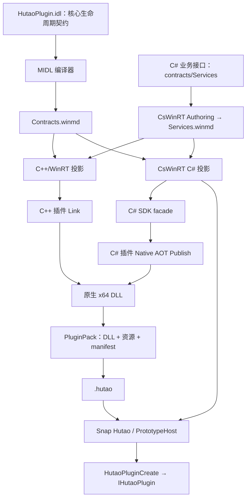
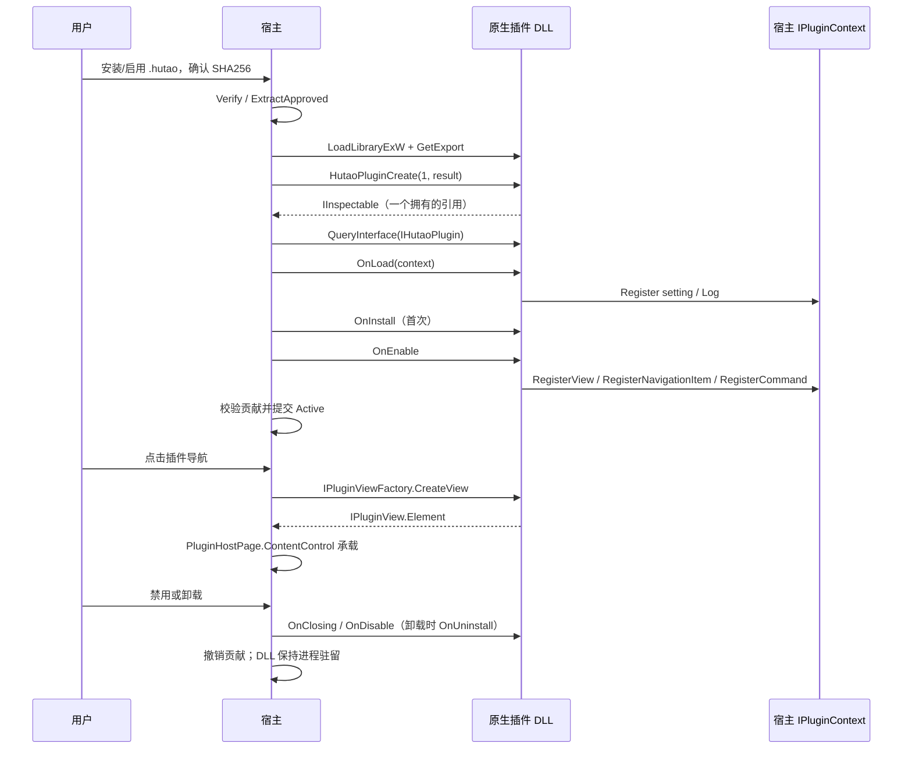

# SDK 2.0 架构与开发模型

## 1. 首先理解插件到底是什么

Snap Hutao 的插件是一个由宿主加载到自身进程的 x64 原生 DLL，不是另一个 WinUI Application，也不是宿主通过反射加载的 C# 类库。C++ 与 C# Native AOT（Ahead-of-Time，提前编译为机器代码）都可以生成这种 DLL。宿主只认识一个公共 WinRT ABI（Application Binary Interface，二进制调用约定和接口布局），不认识插件的 C++ 实现类型或 C# CLR 类型。插件和宿主共享 Windows 原生 WinUI 对象、UI 线程和进程权限，但独立 Native AOT 模块不共享托管运行时状态。

上图中的箭头是构建产物或使用关系，不代表宿主在运行时启动 MIDL、NuGet 或其他构建工具。

新增业务 API 采用 **C# First**：C# 接口经 CsWinRT Authoring 生成 Services.winmd，和核心 Contracts.winmd 一起生成投影；插件通过 GetService 访问宿主真实服务。第一项服务是游戏路径定位。详见 [Authoring 架构、开发与联合验收](PluginSDK2-Authoring.md)。核心 IDL 暂不迁移。

## 2. NuGet SDK 是什么？一定要用吗？

C# 插件代码需要编译器认识 `HutaoPlugin`、`PluginContext` 和 `IPluginContext` 等类型。我们将现成的 C# 投影和开发辅助代码作为 NuGet 包分发，插件作者用 PackageReference 引用即可，不需要编译或引用 Snap Hutao 主程序。Native AOT 发布会将插件所使用的托管代码编译进插件自身的原生 DLL；安装和运行 .hutao 时不需要 NuGet 客户端、SDK nupkg、宿主源码或额外加载一个 SDK 托管 DLL。NuGet 只是分发和依赖解析手段，不是插件运行时，也不提供热重载。

| 组件 | 实际内容 | 谁使用 |
|---|---|---|
| Snap.Hutao.Plugin.Projection.nupkg | 由 CsWinRT 生成的接口投影与 PluginAbi 封送辅助代码 | C# SDK；宿主源码通过同一投影项目获取等价代码 |
| Snap.Hutao.Plugin.SDK.nupkg | HutaoPlugin、PluginContext、PluginSetting、PluginExport、回调 adapter；依赖投影 | C# 插件作者，通常只需直接引用此 SDK，再按模板配置 WinAppSDK 和 CsWinRT |
| native/include + native/metadata | HutaoPlugin.hpp、C ABI 头文件、WinMD、IDL | C++ 插件作者；C++ 不依赖上述两个 C# 包 |
| PluginPack.exe | ZIP 生成、文件哈希、manifest 和 PE 验证 | 两种语言开发者 |
| PrototypeHost.exe | 运行、显示、调试真实插件 DLL | 两种语言开发者，可选 |
| .hutao | 原生 DLL 和插件资源、manifest | 最终用户 |

SDK facade（外观封装层）不改变 WinRT ABI。例如 C# 的 `Context.Settings.Register("Counter", 0, "Counter")` 会调用公共 `IPluginSettings.RegisterInt32`，后者真正由宿主实现；不是 NuGet 包自己保存宿主设置。`PluginExport.Create<T>` 将作者的普通 C# 类包装成实现 IHutaoPlugin 的 WinRT 对象。C++ 作者可直接实现 IHutaoPlugin，不需要 C# facade。

三种开发方式：仓库内示例使用 ProjectReference；仓库外推荐本地或公开 NuGet feed；也可以手工引用两个投影/SDK 托管 DLL 并管理所有匹配依赖和 AOT 分析器，但不作为推荐路线。保留两个可打包项目是有价值的，公开发布到 NuGet.org 却不是完成 ABI 或安装插件的前置条件。现有 Build-Sdk.ps1 仅生成本地分发，未公开发布、未完成仓库外验收。v1 的同名 NuGet 1.0.0 是 build-only 包，主要通过 MSBuild targets 自动打包，不能混用。

## 3. 运行时调用链

- IInspectable 是 WinRT 对象基础接口；QueryInterface 根据 IID（接口 GUID）取得所需接口，而不是使用运行时反射。HRESULT 是跨 ABI 的结果码；失败由语言投影变成异常。C# 的 CCW（COM Callable Wrapper）和 RCW（Runtime Callable Wrapper）分别负责将托管实现暴露给 COM、将原生对象投影到托管侧。对象引用按 ABI 约定 AddRef/Release；不要直接跨边界传 CLR 对象地址或 C++ 实现指针。
- IPluginContext、Settings、Contributions 等由宿主创建，插件通过接口调用宿主真实服务。宿主使用自身的导航、通知和设置系统，不把内部 IServiceProvider 暴露给第三方。
- UI STA 是 Single-Threaded Apartment（单线程 COM 单元），控件操作与生命周期在宿主 UI 线程完成。后台工作通过捕获的 IPluginDispatcher 回到 UI。两个 .NET 运行时的 SynchronizationContext.Current 不共享，即使它们在同一个 OS 线程。
- 禁用不是卸载 DLL。Native AOT DLL 不能安全 FreeLibrary；统一驻留策略也适用于 C++，避免仍存在的 COM vtable、回调、XAML 类型和对象引用指向已解除映射的代码。重新编译 DLL 必须重启宿主。

## 4. 源码职责与依赖方向

路径相对于 src/：

| 路径 | 职责 |
|---|---|
| Snap.Hutao.Plugin.SDK/contracts | 核心 HutaoPlugin.idl、HutaoPluginAbi.h |
| Snap.Hutao.Plugin.SDK/contracts/Services | C# Authoring 业务契约，生成 Services.winmd |
| Snap.Hutao.Plugin.SDK/libraries/Snap.Hutao.Plugin.Projection | GenerateHutaoContracts → CsWinRTGenerateProjection；PluginAbi |
| Snap.Hutao.Plugin.SDK/libraries/Snap.Hutao.Plugin.SDK | C# facade 与 adapter；不引用宿主 |
| Snap.Hutao.Plugin.SDK/libraries/Snap.Hutao.Plugin.SDK.Native | C++ 入口辅助头文件 |
| Snap.Hutao.Plugin.SDK/libraries/Snap.Hutao.Plugin.Packaging | 独立包校验库；不加载 DLL |
| Snap.Hutao.Plugin.SDK/tools/PluginPack | 使用 Packaging 的命令行程序 |
| Snap.Hutao.Plugin.SDK/tests/PrototypeHost | 标准 WinUI App.xaml、MainWindow、MainPage；链接正式核心宿主源码 |
| Snap.Hutao.Remastered/Snap.Hutao.Remastered/Service/Plugin | 正式宿主：NativePluginLoader、PluginResidency、PluginSession、PluginHostContext、PluginPriResources、SettingStore、PluginService、PluginPackageStore |
| Snap.Hutao.Remastered/Snap.Hutao.Remastered/UI/Xaml/View/Page | PluginPage、PluginSettingPage、PluginHostPage；管理、编辑设置、承载视图 |

PrototypeHost 复用加载器、驻留、会话、context 和设置存储的源码，但并不运行正式 PluginService 的安装/更新事务或主程序导航逻辑。它是独立调试和 ABI 回归工具，不是生产宿主的替代品。项目模板在 templates/CSharpPlugin 与 templates/CppPlugin；samples/CSharpAot、samples/CppCore、samples/CppCompiled 是独立回归示例而不是第三方插件的必需依赖。

## 5. 我应该怎样开发？

日常在 VS Build / Publish（C# NativeAot profile），然后运行 Pack-Samples.ps1（仓库样例）或 Pack-Plugin.ps1（外部模板）生成 .hutao。MIDL 生成由项目自动执行。Build-Sdk.ps1 仅供 SDK 发行者，Test-Packaging.ps1 仅供维护者回归，不要求插件开发者运行。

SDK 源码根目录按职责分为 contracts（IDL/ABI）、libraries（可复用库）、samples（独立可运行示例）、templates（外部项目起点）、tools（命令行工具）、tests（测试宿主）和 build（构建脚本）。CppCore 与 CppCompiled 是不同 DLL；不再由 ID 选择是否加载 XBF。

原有游戏附加库通过已批准包的 gameLibraries 声明进入主程序已有 Island 启动服务，而不是通过插件 ABI 暴露进程操作。完整旧版代码对照见 [迁移](PluginSDK2-Migration.md)，XAML 资源边界及完整例子见 [XAML](PluginSDK2-Xaml.md)。

| 我需要做什么 | 实际操作 |
|---|---|
| 写 C# 插件 | 使用 CSharpPlugin 模板，引用本地 SDK NuGet，定义入口与 HutaoPlugin，dotnet publish Native AOT |
| 写 C++ 插件 | 使用 CppPlugin 模板，引用 canonical WinMD 和头文件，MSBuild x64 DLL |
| 创建 UI | 程序式控件，或 loose 模式中的 .xaml；C# Binding 参考 AOT 示例，仍需验证 |
| 测试插件 | 准备 staging → PluginPack pack → PrototypeHost Inspect and load → 选择视图/命令 |
| 修改插件代码 | 关闭测试宿主，重新构建、打包、启动；Disable and re-enable 只测试生命周期 |
| 发布给用户 | 分发 .hutao；用户在正式插件管理页检查来源和哈希，确认后启用 |
| 扩展宿主 API | 先设计并审核 ABI/IID、capability、线程、所有权、版本和测试，不直接引用内部业务类型 |

C++ 编译期 Page 使用组件 DLL + 内嵌 PRI；PrototypeHost 的初始化、Click 与异步 ABI 已有用户实测成功报告。主程序已接入相同 PluginPriResources，启用/启动/更新不再拒绝 compiled；新的主程序 JIT/AOT 编译及运行尚未验收。主程序保留 XAML 编译器自动发现控件库 provider，App 显式实现 IXamlMetadataProvider，在生成的 provider 后查询插件 provider。C# 模板和样例使用编译型 XAML，通过同名组件 PRI 和元数据提供程序加载。现有 V2 loose 包继续沿用既有 ABI。完整开发命令见 [开发者上手](PluginSDK2-GettingStarted.md)，接口见 [API](PluginSDK2-API.md)，包规范见 [Packages](PluginSDK2-Packages.md)，历史技术问题见 [Engineering Notes](PluginSDK2-EngineeringNotes.md)，验证证据见 [Testing](PluginSDK2-Testing.md)。
