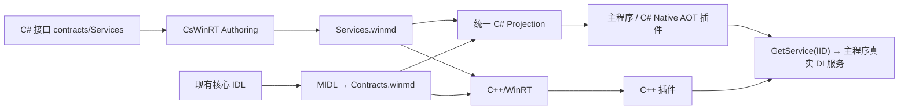

# SDK 2.0：C# First 业务服务 Authoring（Native AOT 优先）

## 架构与目的

胡桃主程序中的服务在自己的 DI 容器中运行。插件只消费公共 WinRT 接口的投影，不引用并重新编译主程序的业务实现。C# First 的含义是新增业务 ABI 由 C# 接口定义，CsWinRT Authoring 自动生成 WinMD，再由 CsWinRT / C++/WinRT 生成消费者的 ABI 代码。不是运行时反射导出所有 public 方法，也不是自动共享 CLR 对象。



原有 HutaoPluginCreate、14 个核心接口及 IID 不变。新增业务契约不再手写 IDL。正式主项目继续实现业务逻辑，Authoring 项目只编译公开契约；这是防止依赖环和把主程序实现带进插件的构建边界。

## 为什么不对整个主程序直接打开 CsWinRTComponent？

CsWinRT 2.3.1 的 Authoring 是扫描公开 API 的组件生成器，而不是按任意标记自动选择所有 CLR 方法的代理生成器。当前主程序的 Service/Game/IGameService.cs 已包含 ValueTask<ValueResult<bool,string>>、Func<string,Task<ValueResult<bool,string?>>>、GameAccount 和 IAdvancedCollectionView<GameAccount> 等签名。它们不能原样成为 WinRT ABI。已有 XAML 类型、公开泛型、DI 和其他生成代码也是需要审查的范围。不能通过 suppression 把这些类型变成合法 ABI。

本轮采用单独的 metadata-only Authoring 编译单元，实际业务仍在主项目。将来如果要直接 Authoring 主程序集，必须先限制/重构公开 API 并验证扫描器、XAML 生成、WinMD 和 Native AOT 发布；当前没有这项实测。不要把全项目打开 Authoring 当成已经实现。

### 主项目直接 Authoring 迁移入口

主项目新增 `HutaoMainAuthoring=true` 构建开关，直接在 Snap.Hutao.Remastered.csproj 启用 CsWinRTComponent，而非仅对独立契约项目开启。此路径生成完整组件的 WinMD/ABI 代码（不是 WinMD-only）；Native AOT 发布时使用 CsWinRT 自身的导出生成策略。现有两个公共 WinMD 作为 Authoring 引用输入；不重复生成它们的 C# 消费投影。

```powershell
dotnet build .\src\Snap.Hutao.Remastered\Snap.Hutao.Remastered\Snap.Hutao.Remastered.csproj -c Debug -p:Platform=x64 -p:HutaoMainAuthoring=true -tl:off -bl:authoring.binlog
```

CsWinRT 2.3.1 [Generator.cs](https://github.com/microsoft/CsWinRT/blob/2.3.1.260716.1/src/Authoring/WinRT.SourceGenerator/Generator.cs#L151-L189) 在 CatchWinRTDiagnostics 返回 true 时提前退出，不会输出部分合法接口的 WinMD。其 [DiagnosticUtils.cs](https://github.com/microsoft/CsWinRT/blob/2.3.1.260716.1/src/Authoring/WinRT.SourceGenerator/DiagnosticUtils.cs#L87-L153) 检查公开类型；并没有 3.x 的 ExcludeFromWindowsMetadata 排除能力。CsWinRTIncludes 是消费投影的筛选器，不是 Authoring 白名单。

因此该开关暂时默认关闭：可在直接 Authoring 的构建中逐批解决诊断，但日常开发及 dev 合并不应被未迁移的 public CLR API 阻塞。优先将真正内部类型改为 internal（先审查跨程序集消费者），对必须公开的业务 API 设计 WinRT 兼容签名；不要全局关闭诊断。先实际构建得到错误清单，再逐项修改，直至生成的 Snap.Hutao.Remastered.winmd 可被消费、正常/AOT 发布通过，之后才能考虑默认启用并将 SDK 切换到主程序集产出的元数据。当前 SDK 仍以独立业务契约 WinMD 为稳定输入，避免形成主程序 → Projection → 主程序的构建循环。直接 Authoring 模式尚未在 Windows 验证。

## 第一个真实服务：IHutaoGamePathService

源码：`src/Snap.Hutao.Plugin.SDK/contracts/Services/IHutaoGamePathService.cs`。

```csharp
[Guid("7BB6A48C-5F18-49EA-BF34-0AE91C2DF587")]
public interface IHutaoGamePathService
{
    IAsyncOperation<string> LocateAsync();
}
```

- IID 固定，不改变已有接口的方法顺序。将来扩展不兼容签名使用新接口及新 IID。
- `LocateAsync` 使用现有主程序 `IGameService.GetGamePathAsync()`（内部调用 `IGamePathService.SilentLocateGamePathAsync()`）。找到返回路径，未找到返回空字符串；异常仍通过 HRESULT/WinRT 异步对象传播。它可能同步已定位的游戏路径到主程序配置，因此不是纯只读查询。
- 包需声明 `"game-path"` capability；宿主取得对象及每次调用均检查该能力，调用还要求 Active 阶段和 UI STA。异步任务纳入会话 DrainAsync。插件不能用缓存的接口绕开关闭后的检查。它不是 OS 安全沙箱。
- PrototypeHost 不引用主程序游戏服务，提供明确的 synthetic fixture 路径，经过同样的异步接口完成；真正生产 DI 的验证必须在主程序执行。

C# 插件：

```csharp
Context.RegisterCommand("locate", "Locate game", async () =>
{
    var service = Context.GamePath;
    if (service is null) return; // 未授权/旧宿主/无服务
    string path = await service.LocateAsync();
    // 非空表示定位成功。
});
```

C++/WinRT（头文件模式）：

```cpp
#include <winrt/Snap.Hutao.Plugin.Services.h>

using namespace winrt::Snap::Hutao::Plugin::Services;

auto service = context.GetService(winrt::guid_of<IHutaoGamePathService>()).try_as<IHutaoGamePathService>();
if (service)
{
    auto path = co_await service.LocateAsync();
}
```

模块模式使用 `import winrt.Snap.Hutao.Plugin.Services;`，参考 samples/CppCore。不要在 worker 直接调用该服务；通过已有 dispatcher 返回 UI。C# facade 使用具体接口转换而不是依赖反射动态发现任意服务类型。无需激活新 runtimeclass，也无需 DllGetActivationFactory 来创建游戏服务。

## 构建机制与 AOT

Authoring 项目设置 CsWinRTComponent=true，使用完整组件生成流程；不启用 CsWinRTGenerateWinMDOnly。CsWinRT 2.3.1 同时开启二者会生成 ExportsType.g.cs，却跳过生成它依赖的 WinRT.Module，导致 CS0234。关闭 CsWinRTGenerateProjection 和 CsWinRTAotExportsEnabled；尽管生成组件代码，消费者仍只使用其 WinMD，不链接或激活 Authoring 程序集。详见 [技术记录](PluginSDK2-EngineeringNotes.md)。源码参考 [Generator.cs](https://github.com/microsoft/CsWinRT/blob/2.3.1.260716.1/src/Authoring/WinRT.SourceGenerator/Generator.cs)、[Helper.cs](https://github.com/microsoft/CsWinRT/blob/2.3.1.260716.1/src/Authoring/WinRT.SourceGenerator/Helper.cs)、[Authoring.targets](https://github.com/microsoft/CsWinRT/blob/2.3.1.260716.1/nuget/Microsoft.Windows.CsWinRT.Authoring.targets)。

Projection 以 ReferenceOutputAssembly=false 引用 Authoring 项目；生成的 Services.winmd 放到 artifacts/metadata，与现有 Contracts.winmd 一起成为 CsWinRTInputs，两者的命名空间进入 CsWinRTIncludes。主程序和 C# 插件只消费 Projection；C++ Core 和外部 C++ 模板引用两个 WinMD。Build-Sdk.ps1 随 native SDK 分发 Services.winmd；C# NuGet 的投影 DLL 包含新增接口，不增加运行时依赖于 Authoring DLL。

主程序 PluginHostContext 是 source-visible partial 类型，直接实现生成的接口，CsWinRT 2.x AOT 优化器可分析其 CCW（托管对象暴露给 COM 的包装）及闭合 IAsyncOperation<string> ABI。若使用 OptIn 而非 Auto，需按实际诊断在原始声明添加 GeneratedWinRTExposedType 等必要元数据；不要仅从另一个 Roslyn 生成器的输出中添加属性。没有运行时反射扫描、没有手写 vtable、没有额外 .NET runtime。Native AOT 发布仍要检查实际分析器警告，验证 async/COM reference lifetime。

## 与 SourceGeneration PR #2 协作

[SourceGeneration PR #2](https://github.com/SnapHutaoRemasteringProject/Snap.Hutao.Remastered.SourceGeneration/pull/2) 当前处理 BindableCustomProperty、依赖属性、partial、CsWinRT 2.x OptIn、3.x 条件以及 SHSGAOT001–007。它不是 WinMD 生成器。PR 的 Roslyn 测试已报告通过，但真实 WinUI/Native AOT 测试仍未完成。当前主程序中央版本为 1.3.18，不能仅凭版本号断言等于 PR 源码。

### 本地 NuGet 源与联合构建

仓库默认 NuGet.Config 仍只包含远程源。主程序在指定 HutaoSourceGenerationVersion 且本地 feed 目录存在时，通过 RestoreAdditionalProjectSources 追加本地源。默认路径为仓库根目录 artifacts/local-nuget；可通过 HutaoSourceGenerationFeed 指定其他目录。正常构建不依赖该目录。

先在独立 SourceGeneration checkout 中选择 PR #2 的准确提交并保持工作树干净。然后在胡桃仓库根目录执行：

```powershell
pwsh -File .\src\Snap.Hutao.Plugin.SDK\build\Pack-SourceGenerationReview.ps1 -SourceGenerationRoot C:\Repos\Snap.Hutao.Remastered.SourceGeneration
```

脚本按 Git commit 生成唯一测试包版本（1.3.19-authoringreview.<commit>），输出实际版本和 feed 参数。它不会自动切换 SourceGeneration 分支、合并 PR、上传包，也不会修改用户级 NuGet.Config。将输出的实际版本填入以下命令：

```powershell
$version = '1.3.19-authoringreview.<实际提交哈希>'
dotnet restore .\src\Snap.Hutao.Remastered\Snap.Hutao.Remastered\Snap.Hutao.Remastered.csproj -r win-x64 -p:HutaoSourceGenerationVersion=$version -p:PublishAot=true -p:PublishReadyToRun=false
dotnet publish .\src\Snap.Hutao.Remastered\Snap.Hutao.Remastered\Snap.Hutao.Remastered.csproj -c Release -p:Platform=x64 -r win-x64 -p:PublishAot=true -p:PublishReadyToRun=false -p:HutaoSourceGenerationVersion=$version -tl:off
```

确认 obj/project.assets.json 解析到该本地测试包。如果使用自定义 FeedDirectory，restore 和 publish 都传相同的 HutaoSourceGenerationFeed。若使用 packageSourceMapping，需自行使本地源允许这个包；仓库现有 NuGet.Config 未启用映射。正常构建不设置 HutaoSourceGenerationVersion，仍使用中央版本。独立插件作者的 SDK NuGet 源是 Build-Sdk.ps1 输出的 artifacts/sdk/<version>/nuget，不是本 SourceGeneration 测试 feed。

后续优化：若需要自动化大量业务服务注册，让 SourceGeneration 生成强类型 IID → DI 查找/适配器映射及诊断；不要让它重复实现 CsWinRT Authoring，也不要假定两个 Roslyn generator 可以依序读取彼此产生的语法树。2.x 下推荐把源可见的公开 C# 契约放在单独 Authoring 编译阶段；生成的 WinMD 再由后续 Projection 消费。现阶段注册、capability 与生命周期仍由宿主显式实现；没有自动导出全部业务接口。

## 本地验收（当前未在 Windows 执行）

1. 在 SDK 根目录执行下面的命令，确认两个 WinMD、Projection 生成源码以及 IHutaoGamePathService 固定 IID。
```powershell
dotnet build .\contracts\Services\Snap.Hutao.Plugin.Services.Authoring.csproj -c Release -p:Platform=x64 -tl:off
dotnet build .\libraries\Snap.Hutao.Plugin.Projection\Snap.Hutao.Plugin.Projection.csproj -c Release -p:Platform=x64 -tl:off
Get-ChildItem .\artifacts\metadata\*.winmd
```
2. VS 重建 SDK solution Release x64，发布 CSharpAot NativeAot，Pack-Samples.ps1 -Configuration Release。
3. 分别启动 JIT 和 Native AOT PrototypeHost，加载 CppCore 与 CSharpAot 包，运行 Exercise C# First service 命令。预期 fixture 路径非空、成功日志、await 后 UI thread access 正确。
4. 正式主程序两种发布配置安装同样的包，运行命令；在 PluginService.LocateGamePathAsync 与 IGameService.GetGamePathAsync 下断点，验证确实取得现有 DI 服务。无配置/无法定位时返回空串也属正常业务结果。
5. 去掉 manifest 的 game-path 后重新打包，GetService 应返回 null；使用 QI 取得接口后调用仍应拒绝。测试关闭阶段和后台线程调用、原始 HRESULT、重复调用、禁用重新启用。
6. 检查 SDK pack 与仓库外模板，Authoring 实现 DLL 不应成为运行时依赖；验证 WinMD/IID 在不同构建和语言中一致。全部记录 Pass/Fail/NotRun，不能由生成器测试通过推断 Windows ABI 已通过。

当前仅实现并提交第一项 C# First 真实业务服务与消费链路，其他胡桃业务能力尚未迁移；旧核心 IDL 保留。Windows build、AOT publish、四组合、主程序真实服务、负例与仓库外分发均 NotRun。
