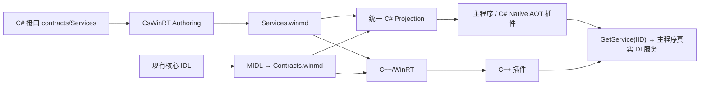

# SDK 2.0：C# First 业务服务 Authoring（Native AOT 优先）

## 架构与目的

胡桃主程序中的服务在自己的 DI 容器中运行。插件只消费公共 WinRT 接口的投影，不引用并重新编译主程序的业务实现。C# First 的含义是新增业务 ABI 由 C# 接口定义，CsWinRT Authoring 自动生成 WinMD，再由 CsWinRT / C++/WinRT 生成消费者的 ABI 代码。不是运行时反射导出所有 public 方法，也不是自动共享 CLR 对象。



原有 HutaoPluginCreate、14 个核心接口及 IID 不变。新增业务契约不再手写 IDL。正式主项目继续实现业务逻辑，Authoring 项目只编译公开契约；这是防止依赖环和把主程序实现带进插件的构建边界。

## 为什么不对整个主程序直接打开 CsWinRTComponent？

CsWinRT 2.3.1 的 Authoring 是扫描公开 API 的组件生成器，而不是按任意标记自动选择所有 CLR 方法的代理生成器。当前主程序的 Service/Game/IGameService.cs 已包含 ValueTask<ValueResult<bool,string>>、Func<string,Task<ValueResult<bool,string?>>>、GameAccount 和 IAdvancedCollectionView<GameAccount> 等签名。它们不能原样成为 WinRT ABI。已有 XAML 类型、公开泛型、DI 和其他生成代码也是需要审查的范围。不能通过 suppression 把这些类型变成合法 ABI。

公开契约放在独立的 Authoring 项目。它使用完整组件生成流程产出 WinMD，主程序继续实现业务服务。这个构建边界让 Projection 可以先读取契约，再供主程序引用。把契约生成放进主程序会让 Projection 依赖主程序，同时让主程序依赖 Projection，形成项目引用循环。

新增服务时，先在 `contracts/Services` 定义 WinRT 能表达的接口并分配稳定 IID（接口标识），再重建 Projection，最后在主程序的 `PluginHostContext` 实现授权与分发。比如返回字符串的异步方法使用 `IAsyncOperation<string>`，由宿主内部把现有异步服务接到该 WinRT 接口。接口签名和宿主实现可以独立演进。

### 复现主程序集直接 Authoring 的诊断

在命令行将 CsWinRT 自带的 `CsWinRTComponent` 设为 `true` 可复现主程序集实验。主项目会开启诊断日志，并把既有的 `Contracts.winmd`、`Services.winmd` 作为输入，供生成器解析接口引用。MSBuild 默认会把 `-p` 属性传给项目引用，主项目通过 `GlobalPropertiesToRemove` 限制该开关只作用于自己。独立契约项目按自身配置继续生成 WinMD。

```powershell
$project = '.\src\Snap.Hutao.Remastered\Snap.Hutao.Remastered\Snap.Hutao.Remastered.csproj'
dotnet build $project -c Debug -p:Platform=x64 -p:CsWinRTComponent=true -tl:off -bl:authoring.binlog
```

在 `authoring.binlog` 搜索 CsWinRT 诊断。CsWinRT 2.3.1 会在公开声明不满足 WinRT 规则时终止本次 Authoring，连合法的接口也不会得到部分 WinMD。对于上面的 `ValueTask<ValueResult<...>>`，应先定义 WinRT 能表达的服务接口，再在宿主内部适配原有返回类型。消费端的 `CsWinRTIncludes` 只限定要生成投影的命名空间，无法改变组件端扫描的公开声明。独立 Authoring 项目还遇到过 WinMD-only 模式产生 `ExportsType.g.cs` 却缺少 `WinRT.Module` 的问题，见下文构建机制。主程序集迁移的成功条件是公开接口通过扫描、生成 WinMD 可被消费者引用，以及普通版和 Native AOT 版均通过 Windows 验证。参见 [CsWinRT 2.3.1 生成器实现](https://github.com/microsoft/CsWinRT/blob/2.3.1.260716.1/src/Authoring/WinRT.SourceGenerator/Generator.cs#L151-L189) 和 [SourceGeneration #1](https://github.com/SnapHutaoRemasteringProject/Snap.Hutao.Remastered.SourceGeneration/issues/1)。

## 第一个真实服务：IHutaoGamePathService

源码：`src/Snap.Hutao.Plugin.SDK/contracts/Services/IHutaoGamePathService.cs`。

```csharp
[Guid("7BB6A48C-5F18-49EA-BF34-0AE91C2DF587")]
public interface IHutaoGamePathService
{
    IAsyncOperation<string> LocateAsync();
}
```

- IID 固定，不改变已有接口的方法顺序。将来扩展不兼容签名使用新接口及新 IID。
- `LocateAsync` 使用现有主程序 `IGameService.GetGamePathAsync()`（内部调用 `IGamePathService.SilentLocateGamePathAsync()`）。找到返回路径，未找到返回空字符串；异常仍通过 HRESULT/WinRT 异步对象传播。它可能同步已定位的游戏路径到主程序配置，因此不是纯只读查询。
- 包需声明 `"game-path"` capability；宿主取得对象及每次调用均检查该能力，调用还要求 Active 阶段和 UI STA。异步任务纳入会话 DrainAsync。插件不能用缓存的接口绕开关闭后的检查。它不是 OS 安全沙箱。
- PrototypeHost 不引用主程序游戏服务，提供明确的 synthetic fixture 路径，经过同样的异步接口完成；真正生产 DI 的验证必须在主程序执行。

C# 插件：

```csharp
Context.RegisterCommand("locate", "Locate game", async () =>
{
    var service = Context.GamePath;
    if (service is null) return; // 未授权/旧宿主/无服务
    string path = await service.LocateAsync();
    // 非空表示定位成功。
});
```

C++/WinRT（头文件模式）：

```cpp
#include <winrt/Snap.Hutao.Plugin.Services.h>

using namespace winrt::Snap::Hutao::Plugin::Services;

auto service = context.GetService(winrt::guid_of<IHutaoGamePathService>()).try_as<IHutaoGamePathService>();
if (service)
{
    auto path = co_await service.LocateAsync();
}
```

模块模式使用 `import winrt.Snap.Hutao.Plugin.Services;`，参考 samples/CppCore。不要在 worker 直接调用该服务；通过已有 dispatcher 返回 UI。C# facade 使用具体接口转换而不是依赖反射动态发现任意服务类型。无需激活新 runtimeclass，也无需 DllGetActivationFactory 来创建游戏服务。

## 构建机制与 AOT

Authoring 项目设置 CsWinRTComponent=true，使用完整组件生成流程；不启用 CsWinRTGenerateWinMDOnly。CsWinRT 2.3.1 同时开启二者会生成 ExportsType.g.cs，却跳过生成它依赖的 WinRT.Module，导致 CS0234。关闭 CsWinRTGenerateProjection 和 CsWinRTAotExportsEnabled；尽管生成组件代码，消费者仍只使用其 WinMD，不链接或激活 Authoring 程序集。详见 [技术记录](PluginSDK2-EngineeringNotes.md)。源码参考 [Generator.cs](https://github.com/microsoft/CsWinRT/blob/2.3.1.260716.1/src/Authoring/WinRT.SourceGenerator/Generator.cs)、[Helper.cs](https://github.com/microsoft/CsWinRT/blob/2.3.1.260716.1/src/Authoring/WinRT.SourceGenerator/Helper.cs)、[Authoring.targets](https://github.com/microsoft/CsWinRT/blob/2.3.1.260716.1/nuget/Microsoft.Windows.CsWinRT.Authoring.targets)。

Projection 以 ReferenceOutputAssembly=false 引用 Authoring 项目；生成的 Services.winmd 放到 artifacts/metadata，与现有 Contracts.winmd 一起成为 CsWinRTInputs，两者的命名空间进入 CsWinRTIncludes。主程序和 C# 插件只消费 Projection；C++ Core 和外部 C++ 模板引用两个 WinMD。Build-Sdk.ps1 随 native SDK 分发 Services.winmd；C# NuGet 的投影 DLL 包含新增接口，不增加运行时依赖于 Authoring DLL。

生成 `Contracts.winmd` 时，MIDL（编译接口定义的工具）优先使用项目 `TargetPlatformVersion` 对应的 Windows SDK，目前为 10.0.26100.0。该版本不完整时，选择已安装的较新完整版本。MIDL 工具、`Windows.winmd` 和头文件始终来自同一套 SDK。构建输出会记录选中版本。

主程序 PluginHostContext 是 source-visible partial 类型，直接实现生成的接口，CsWinRT 2.x AOT 优化器可分析其 CCW（托管对象暴露给 COM 的包装）及闭合 IAsyncOperation<string> ABI。若使用 OptIn 而非 Auto，需按实际诊断在原始声明添加 GeneratedWinRTExposedType 等必要元数据；不要仅从另一个 Roslyn 生成器的输出中添加属性。没有运行时反射扫描、没有手写 vtable、没有额外 .NET runtime。Native AOT 发布仍要检查实际分析器警告，验证 async/COM reference lifetime。

## 主程序如何消费 SourceGeneration

[SourceGeneration PR #2](https://github.com/SnapHutaoRemasteringProject/Snap.Hutao.Remastered.SourceGeneration/pull/2) 已合并，主程序从正常 NuGet 源还原 [1.3.19](https://www.nuget.org/packages/Snap.Hutao.Remastered.SourceGeneration/1.3.19)，版本在仓库根目录的 `Directory.Packages.props`。这个 Roslyn 源生成器为 C# 类型生成依赖属性、绑定相关的代码和诊断。编译 Windows Runtime 契约为 WinMD 的工作由独立 Authoring 项目的 CsWinRT 完成。

如果编译报 `SHSGAOT`，先根据诊断找到原始类型声明。Roslyn 的两个源生成器读取同一份输入声明，不能假定一个生成器会在同一次编译中看到另一个生成器刚生成的属性。WinRT AOT 所需的 opt-in 元数据应按诊断放在输入源码上。[源生成器验收指南](https://github.com/SnapHutaoRemasteringProject/Snap.Hutao.Remastered.SourceGeneration/blob/main/docs/developer-validation.md) 说明如何运行测试、检查生成文件和核对应用实际还原的版本。

## 本地验收（当前未在 Windows 执行）

1. 在 SDK 根目录执行下面的命令，确认两个 WinMD、Projection 生成源码以及 IHutaoGamePathService 固定 IID。
```powershell
dotnet build .\contracts\Services\Snap.Hutao.Plugin.Services.Authoring.csproj -c Release -p:Platform=x64 -tl:off
dotnet build .\libraries\Snap.Hutao.Plugin.Projection\Snap.Hutao.Plugin.Projection.csproj -c Release -p:Platform=x64 -tl:off
Get-ChildItem .\artifacts\metadata\*.winmd
```
2. VS 重建 SDK solution Release x64，发布 CSharpAot NativeAot，Pack-Samples.ps1 -Configuration Release。
3. 分别启动 JIT 和 Native AOT PrototypeHost，加载 CppCore 与 CSharpAot 包，运行 Exercise C# First service 命令。预期 fixture 路径非空、成功日志、await 后 UI thread access 正确。
4. 正式主程序两种发布配置安装同样的包，运行命令；在 PluginService.LocateGamePathAsync 与 IGameService.GetGamePathAsync 下断点，验证确实取得现有 DI 服务。无配置/无法定位时返回空串也属正常业务结果。
5. 去掉 manifest 的 game-path 后重新打包，GetService 应返回 null；使用 QI 取得接口后调用仍应拒绝。测试关闭阶段和后台线程调用、原始 HRESULT、重复调用、禁用重新启用。
6. 检查 SDK pack 与仓库外模板，Authoring 实现 DLL 不应成为运行时依赖；验证 WinMD/IID 在不同构建和语言中一致。全部记录 Pass/Fail/NotRun，不能由生成器测试通过推断 Windows ABI 已通过。

当前仅实现并提交第一项 C# First 真实业务服务与消费链路，其他胡桃业务能力尚未迁移；旧核心 IDL 保留。Windows build、AOT publish、四组合、主程序真实服务、负例与仓库外分发均 NotRun。
