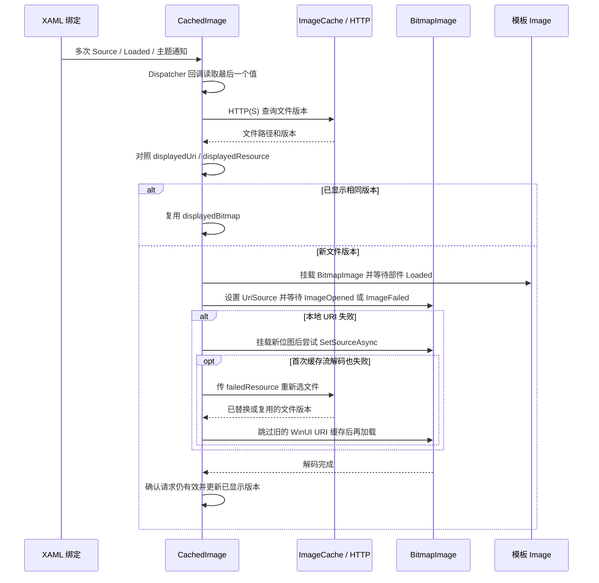

# CachedImage 开发交接

本文按「数据源 → 地址转换 → 请求与缓存 → 解码 → 界面提交」追踪一张图。包内快照的准备和交付见[内置图片资源指南](bundled-images.zh-CN.md)。

## 1. 从页面定位图片来源

排查某一张坏图或闪烁时，先在页面 XAML 找到对应的 `CachedImage.Source`。同一个页面可能同时使用角色头像、祈愿立绘、建议列表图标和本地资源，它们进入控件前走不同的路径。

| 页面元素 | 绑定入口 | URI 从哪里来 |
| --- | --- | --- |
| Wiki 角色侧脸图 | [WikiAvatarPage.xaml](../src/Snap.Hutao.Remastered/Snap.Hutao.Remastered/UI/Xaml/View/Page/WikiAvatarPage.xaml) 中 `Source="{x:Bind SideIcon, Converter={StaticResource AvatarSideIconConverter}, Mode=OneWay}"` | 元数据 `Avatar.SideIcon` 是资源名。转换器映射到 `AvatarIcon/<资源名>.png` |
| Wiki 祈愿立绘 | 同一页 `ViewModel.Avatars.CurrentItem.Icon` 与 `GachaAvatarImgConverter` | 转换器从图标名提取角色段，再映射到 `GachaAvatarImg/UI_Gacha_AvatarImg_<角色名>.png`。衣装面板有独立的 `CostumeConverter` 和可见性绑定 |
| 角色资料头像 | [AvatarPropertyPage.xaml](../src/Snap.Hutao.Remastered/Snap.Hutao.Remastered/UI/Xaml/View/Page/AvatarPropertyPage.xaml) 中 `Source="{x:Bind SideIcon, Mode=OneWay}"` | 绑定的是 `AvatarView.SideIcon`，已经是 `Uri`。[SummaryAvatarFactory](../src/Snap.Hutao.Remastered/Snap.Hutao.Remastered/Service/AvatarInfo/Factory/SummaryAvatarFactory.cs) 调用 [SetCostumeIconOrDefault](../src/Snap.Hutao.Remastered/Snap.Hutao.Remastered/Service/AvatarInfo/Factory/Builder/AvatarViewBuilderExtension.cs)，按账号角色当前衣装选 `FrontIcon/SideIcon`，或者使用元数据的默认图标，再调用 `AvatarIconConverter` |
| Wiki 搜索建议图标 | 同一页建议项模板直接绑定 `SearchToken.IconUri` 或 `SideIconUri` | [SearchData.CreateForWikiAvatar](../src/Snap.Hutao.Remastered/Snap.Hutao.Remastered/UI/Xaml/Control/AutoSuggestBox/SearchData.cs) 调用 [SearchTokens.GetForWikiAvatar](../src/Snap.Hutao.Remastered/Snap.Hutao.Remastered/UI/Xaml/Control/AutoSuggestBox/SearchTokens.cs)；角色建议的侧脸 URI 在这里由 `AvatarSideIconConverter` 提前生成 |
| XAML 静态资源或直接 URL | 比如 Wiki 页的 `UI_EmotionIcon89` 或直接声明的 HTTPS 地址 | 直接使用绑定展开后的值，逐项检查资源字典和该处 XAML。不能用角色转换器的结果推断这些图片的来源 |

以 Wiki 的侧脸图为例，断点可以按以下顺序下。

```text
WikiAvatarViewModel.LoadOverrideAsync
  -> IMetadataService.GetContextAsync<WikiAvatarMetadataContext>
  -> MetadataServiceContextExtension 填入 Avatars
     proto 路径由 AvatarAdapter 将 message.SideIcon 映射到 Avatar.SideIcon
  -> Avatars / CurrentItem 进入 WikiAvatarPage 的 XAML
  -> AvatarSideIconConverter.Convert / IconNameToUri
  -> StaticResourcesEndpoints.StaticRaw("AvatarIcon", $"{name}.png")
  -> CachedImage.OnSourceChanged
```

有关文件见 [WikiAvatarViewModel](../src/Snap.Hutao.Remastered/Snap.Hutao.Remastered/ViewModel/Wiki/WikiAvatarViewModel.cs)、[元数据上下文装填](../src/Snap.Hutao.Remastered/Snap.Hutao.Remastered/Service/Metadata/ContextAbstraction/MetadataServiceContextExtension.cs)、[AvatarAdapter](../src/Snap.Hutao.Remastered/Snap.Hutao.Remastered/Service/Metadata/Provider/Proto/Mapper/AvatarAdapter.cs)、[AvatarSideIconConverter](../src/Snap.Hutao.Remastered/Snap.Hutao.Remastered/Model/Metadata/Converter/AvatarSideIconConverter.cs) 和 [GachaAvatarImgConverter](../src/Snap.Hutao.Remastered/Snap.Hutao.Remastered/Model/Metadata/Converter/GachaAvatarImgConverter.cs)。Proto 元数据传输的边界见 [元数据说明](proto-metadata.md)。

当资源名为 `UI_AvatarIcon_Side_Ayaka` 时，默认域名下生成地址如下。用同一实际 URL 对照缓存键，保留大小写和查询串。

```text
https://api.snaphutaorp.org/static/raw/AvatarIcon/UI_AvatarIcon_Side_Ayaka.png
```

[StaticResourcesEndpoints.StaticRaw](../src/Snap.Hutao.Remastered/Snap.Hutao.Remastered/Web/Endpoint/Hutao/StaticResourcesEndpoints.cs) 按 `{Root}/static/raw/{category}/{fileName}` 拼接。`Root` 每次从 [ServerDomainService.GetApiRoot](../src/Snap.Hutao.Remastered/Snap.Hutao.Remastered/Web/ServerDomainService.cs) 取值。主域是 `https://api.snaphutaorp.org`，备用域是 `https://api.hutaorp.org`。切换域名后生成的新 URL 会产生不同缓存键。

## 2. 控件入口与分流

[CachedImage](../src/Snap.Hutao.Remastered/Snap.Hutao.Remastered/UI/Xaml/Control/Image/CachedImage.cs) 绑定到模板中名为 `Image` 的 WinUI 部件。模板定义见 [CachedImage.xaml](../src/Snap.Hutao.Remastered/Snap.Hutao.Remastered/UI/Xaml/Control/Image/CachedImage.xaml)。

1. `OnSourceChanged`、`OnLoaded`、`OnApplyTemplate` 和单色模式下的 `OnActualThemeChanged` 把更新交给 `QueueSourceUpdate`。一个控件队列中只有一个待处理的 Dispatcher 回调。回调读取当时最后一次绑定的来源和主题。
2. `UpdateSource` 要求模板部件存在、控件已经加载、应用仍在运行。`GetSourceText` 把 `Uri` 转回 `OriginalString`，因而内容相同的字符串和 URI 共用一个活动请求。`SourceRequest` 持有来源、有效主题和取消令牌。
3. `LoadSourceAsync` 调用 `ApplySourceAsync`。这里解析地址、取得文件或包 URI，再执行对应的解码分支。取消只影响本控件的待提交结果和它发出的 WinUI 流解码取消，不会取消其他控件可能还需要的共享缓存下载。

| 转换后的 URI | `ApplySourceAsync` 的行为 |
| --- | --- |
| HTTP 或 HTTPS | 切到后台取进程内单例 `IImageCache`，调用 `GetImageAsync(uri, theme, failed)` 后将返回文件转为本地 URI |
| 本地文件 URI | 直接交给 WinUI URI 解码。URI 解码失败时尝试文件流，不调用 HTTP 图片缓存 |
| 相对路径或 `ms-appx:///` | 相对路径补 `ms-appx:///`。Unpackaged 由 `InstalledLocation.ToAbsoluteUri` 映射到安装目录；MSIX 保留包资源 URI |
| 其他绝对 URI | 交给 WinUI 的 `BitmapImage.UriSource` |
| 空来源 | 在队列更新中调用 `ClearImage`，清除显示对象与文件版本 |

## 3. 从 URL 到真正的文件

[IImageCache](../src/Snap.Hutao.Remastered/Snap.Hutao.Remastered/Core/Caching/IImageCache.cs) 由 [ImageCache](../src/Snap.Hutao.Remastered/Snap.Hutao.Remastered/Core/Caching/ImageCache.cs) 实现。先在 `GetImageAsync` 查看 `uri.OriginalString` 和 `theme`，随后进 `GetSourceFileAsync` 判断命中的分支。

```text
GetImageAsync(uri, theme, failedResource)
  ImageCacheFile.Create(CacheFolder, uri)
    -> uppercase_hex(SHA1(UTF8(uri.OriginalString)))
  AsyncKeyedLock.LockAsync(HashedFileName)
    GetSourceFileAsync
      1. 可写原图文件，存在且非空
      2. BundledImages 清单中的资源路径，文件存在且长度与条目一致
      3. ImageCacheDownloadOperation.DownloadFileAsync
    ElementTheme.Default -> 返回原图
    Light/Dark -> 复用或生成主题派生 PNG
```

磁盘目录为 `HutaoRuntime.LocalCacheDirectory/ImageCache`。MSIX 的根是包 `LocalCacheFolder`，Unpackaged 的根是 `AppDataPaths.UnpackagedRoot/Cache`。原图文件名无扩展名，派生文件分放 `Light/<哈希>` 与 `Dark/<哈希>`。见 [缓存目录定义](../src/Snap.Hutao.Remastered/Snap.Hutao.Remastered/Core/HutaoRuntime.cs) 和 [ImageCacheFile](../src/Snap.Hutao.Remastered/Snap.Hutao.Remastered/Core/Caching/ImageCacheFile.cs)。手工排查路径时可按源码计算同一个缓存键。

```powershell
$url = 'https://api.snaphutaorp.org/static/raw/AvatarIcon/UI_AvatarIcon_Side_Ayaka.png'
$key = [Convert]::ToHexString([Security.Cryptography.SHA1]::HashData([Text.Encoding]::UTF8.GetBytes($url)))
$key
```

内置包路径由 `BundledImageResources` 定位。只对当前静态域的 `/static/raw/` URL 作相对路径解析，带查询串或片段时跳过。随后 [ImageResourceBundle.Find](../src/Snap.Hutao.Remastered/Snap.Hutao.Remastered/Core/Caching/ImageResourceBundle.cs) 按清单和长度找文件。普通命中只检查元数据，字节是否真的能解码由下一层确认。ZIP 导入及设置页去重涉及内容同一性时才按清单路径、长度与 SHA-256 判断。

[CachedImageResource](../src/Snap.Hutao.Remastered/Snap.Hutao.Remastered/Core/Caching/CachedImageResource.cs) 保存 `File`、`LastWriteTimeUtc` 和 `Length`。它是文件观察值，用来确认重试针对的是哪次读取。相同路径、时间和长度的重写会被视为同一版本。进程内锁以哈希为键，覆盖查找、下载、派生生成、ZIP 导入和重复缓存清理。另有历史调用方只需要文件路径，走 `GetFileFromCacheAsync`。

### HTTP 请求与写入边界

只有在可写缓存和内置包都无法提供文件时才走 [ImageCacheDownloadOperation](../src/Snap.Hutao.Remastered/Snap.Hutao.Remastered/Core/Caching/ImageCacheDownloadOperation.cs)。

| 阶段 | 调用和数据 |
| --- | --- |
| 构造 | `IHttpRequestMessageBuilderFactory.Create().SetRequestUri(uri).SetStaticResourceControlHeadersIfRequired().Get()`。地址是原始图片 URL，方法是 GET |
| 静态资源头 | [StaticResourceHttpHeaderBuilderExtension](../src/Snap.Hutao.Remastered/Snap.Hutao.Remastered/Web/Endpoint/Hutao/StaticResourceHttpHeaderBuilderExtension.cs) 比较请求 authority 与当前 `Root`。匹配时添加 `x-hutao-quality` / `x-hutao-archive`，取本地设置，缺省为 `Original` / `Full` |
| 客户端配置 | `IHttpClientFactory.CreateClient(nameof(ImageCacheDownloadOperation))`，每服务器 8 个连接。默认配置仍设置设备头、User-Agent 和系统代理。见 [ServiceCollectionExtension.HttpClient](../src/Snap.Hutao.Remastered/Snap.Hutao.Remastered/Core/DependencyInjection/ServiceCollectionExtension.HttpClient.cs) |
| 中间件 | [ServerDomainRedirectHandler](../src/Snap.Hutao.Remastered/Snap.Hutao.Remastered/Core/IO/Http/ServerDomainRedirectHandler.cs) 处理绝对地址重定向，最多 5 次。HTTP GET 的 5xx 或 `HttpRequestException` 可由 [RetryHttpHandler](../src/Snap.Hutao.Remastered/Snap.Hutao.Remastered/Core/IO/Http/RetryHttpHandler.cs) 进行最多 3 次发送尝试。这里统计的是网络请求尝试，发生在解码前 |
| 接收和落盘 | `SendAsync(..., ResponseHeadersRead)`。验证 HTTP 状态，拒绝声明为 `application/json` 或 `text/html` 的响应。流复制到同目录的 `<哈希>.<GUID>.tmp`。复制非空并关闭输出流后检查取消，再 `File.Move(..., overwrite: true)`。退出时清理临时文件 |

因此看到多次 HTTP 请求，要先区分重定向、重试中间件和坏文件恢复三条链路。缓存键始终来自转换器传入的原始 URL。响应体复制途中失败时，正式缓存文件不会收到半截响应。若前面已删除坏文件且恢复下载失败，缓存会暂时缺失。

### 派生图和坏文件恢复

单色模式先得到原图，再检查派生 PNG 是否非空、时间戳不早于原图并且不等于失败版本。重建调用 [MonoChromeImageConverter](../src/Snap.Hutao.Remastered/Snap.Hutao.Remastered/Core/Caching/MonoChromeImageConverter.cs)，用 WIC 解码，像素亮度写入透明度，Light 颜色为黑，Dark 为白。派生 PNG 用临时文件写完再替换。WIC 抛出 `IsInvalidImage` 列出的格式、组件、头部或流错误时，尝试替换原图并重新生成一次。

WinUI 加载本地文件 URI 失败时，先用 `LoadStreamBitmapAsync` 检查该文件能否通过流解码。流解码也失败且有缓存版本时，`ApplySourceAsync` 将该次读取的 `CachedImageResource` 作为 `failedResource` 重试一次。进入 `GetSourceFileAsync` 后，当前可写文件与失败标识相等才删除。已被其他请求替换的文件可以直接复用，失败的内置版本本次会跳过。内置目录保持只读。若失败文件是派生图，则先用原图重建派生图。下一次仍失败或取得文件前就报错时，`LoadSourceAsync` 尝试不同于原图的 `PlaceholderSource`，或者调用 `ClearImage`。

## 4. 解码与界面提交的时机

这里区分「收到一个新绑定值」「完成一次解码」和「向模板提交一张图」。看到页面闪一次并不代表发了第二次 HTTP 请求。



- **去重时机**。来源字符串与主题相同的活动请求不会重开。卸载会取消活动请求；重新加载可以复查磁盘，但地址和文件版本相同时仍复用 `displayedBitmap`。重套模板时 `OnApplyTemplate` 把已显示的位图交给新模板部件。
- **挂载和解码顺序**。`AttachBitmapAsync` 先把位图设到可见的模板 `Image`，等该部件 Loaded，再设置 `UriSource`。解码由已经挂到布局树的 WinUI Image 发起。没有手动设置解码宽高。见 [WinUI 的按显示尺寸解码说明](https://learn.microsoft.com/windows/apps/develop/performance/optimize-animations-and-media#right-sized-decoding)。
- **URI 复用和失败后备**。普通路径让 WinUI 按 URI 复用图像资源。同路径文件已变化或本次正在恢复坏缓存时使用 `IgnoreImageCache`。本地文件 URI 失败才打开 `FileStream`，以 `FileShare.Read | FileShare.Delete` 读取并对已挂载的位图调用 `SetSourceAsync`。非文件 URI 失败走占位图路径。
- **迟到结果**。地址或主题改变时先取消旧请求，即使 Dispatcher 批次还没执行。卸载也会取消。解码完成后回 UI 线程再次检查令牌和应用退出状态，丢弃不再有效的结果。
- **界面字段**。`displayedUri` 和 `displayedResource` 用于比较已经显示的文件，`displayedBitmap` 用于换模板时复用。新位图由 `AttachBitmapAsync` 写入模板。复用、清空和同步新模板部件由 `ApplyDisplayedImage` 完成，后者会先比较位图引用。复制图片需要本地 `displayedUri`，复制命令用 WIC 把文件读入并输出 PNG。

之前尝试在位图挂载前对每个控件独立流解码，导致正常图片也失去按显示尺寸解码和 URI 资源复用。现在重新采用挂载后加载。日志里的真实换图如果来自成批的新控件，仍要沿页面的模板、列表和虚拟化边界继续检查。

## 5. 开发排查入口

### 区分实际换图和控件重建

在 `AttachBitmapAsync` 和 `ApplyDisplayedImage` 的 `Image.Source` 写入处下断点，按控件实例和当前 URI 分组。先比较上一条与当前记录的来源、主题和部件，再去看同一时段的 `OnLoaded`、`OnUnloaded` 和 `OnApplyTemplate`。若画面变化时没有发生写入，查看布局尺寸、DPI 和控件的可视状态。HTTP 请求另从 `ImageCacheDownloadOperation` 或 `Begin to download file` breadcrumb 核对。

排查期间的临时追踪记录如下。逐事件追踪已从实现移除，原有的错误诊断仍可用。

| 样本 | 结果 |
| --- | --- |
| 改回 URI 路径之前 | 888 次图片写入分属 888 个控件。887 次缓存查找命中本地，期间没有进入下载或坏缓存恢复。 |
| 改回 URI 路径之后 | 738 个控件有 758 次写入，全部使用 URI 路径。重复写入来自绑定地址变化，其中三处呈现 A → B → A。没有同一控件连续写入相同地址和主题的记录。182 次指针进入后的半秒内，同一控件没有发生新写入。有 8 个属性图标进入下载后失败，属于单独的资源获取问题。 |

[WinUI #12807](https://github.com/microsoft/microsoft-ui-xaml/issues/12807) 涉及 `ImageBrush` 在旋转或元素缩放场景中的解码尺寸。本页所追踪的头像使用 `CachedImage` 模板里的普通 `Image`，日志没有显示该问题描述的变换路径。

| 现象 | 先检查什么 |
| --- | --- |
| 资源名或分类错 | 在页面的 XAML 查出具体 `Source`，查转换器输入、`StaticRaw` 的 category 和 filename。元数据角色名与图片资源名是不同字段 |
| 地址正确但 CDN 返回错误 | 在 `DownloadFileUsingHttpClientAsync` 查 URI、状态码、`Content-Type`、选中的主备域、HTTP 重试或重定向。 `Begin to download file` Breadcrumb 有原始地址和最终缓存路径 |
| 没有网络请求却闪图 | 在 `QueueSourceUpdate` 和 `ApplyDisplayedImage` 记录控件实例、`SourceRequest.Source/Theme`、模板部件引用及 `displayedResource`。同一控件提交不同位图时查路径或文件版本变化。多个新控件实例需要继续追踪页面的 `ItemsSource` 与虚拟化 |
| 磁盘非空但图不显示 | 先在 `LoadUriBitmapAsync` 的 `OnFailed` 查 URI，再到 `LoadStreamBitmapAsync` 查本地路径。两次均失败时应出现使用旧文件标识的恢复请求 |
| 只有主题图出错 | 先记录 `GetImageAsync` 的源文件和派生文件时间；WIC 错误发生在 `CreateThemedMonochromeFileAsync` 时，WinUI 还没有开始加载派生图 |
| 已切换角色却出现上一张图 | 先区分等待文件时保留的上一张图与迟到结果。若旧请求在新请求之后覆盖控件，检查请求令牌、`IsCurrent` 和实际 `Image.Source` 的写入者 |

### 回归检查

分别记录 HTTP 发送次数、流解码次数和模板 `Image.Source` 写入次数。下列场景应分别验收。

1. 给同一个已显示控件依次绑定同一 URL 的 `Uri` 和字符串，并让模板重套。当前文件版本应复用。模板部件被替换时只向新部件同步一次。
2. 将已有正常图换为冷缓存的另一张图。缓存返回后把新位图挂载到模板部件，随后触发 URI 解码。连续更换多个来源时，过期请求不得覆盖最终来源。
3. 预置非空坏缓存，网络回复有效图片。URI 与流均失败时触发一次缓存恢复。恢复失败时验证占位或清空。
4. 同一 URL 同时交给多个不同控件。首次成功恢复之后，其余控件可共享新文件；每个控件拥有自己的位图。
5. 遇到空响应、断流和 JSON 响应，检查没有半截正式文件遗留。分别回归 Light/Dark、MSIX 和 unpackaged 的资源路径。

先前已在 Native AOT 中用真实控件验证坏缓存恢复。本次修订的验收还需覆盖真实页面中的重绑和回收时序，合成缓存通过不能替代这一步。
